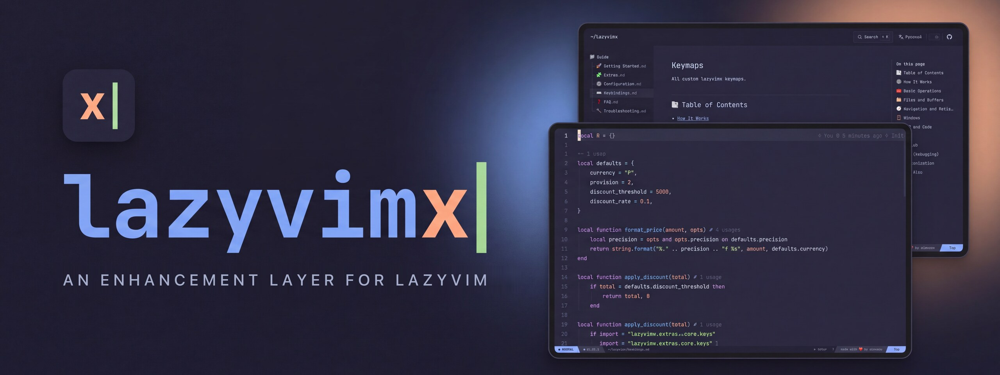
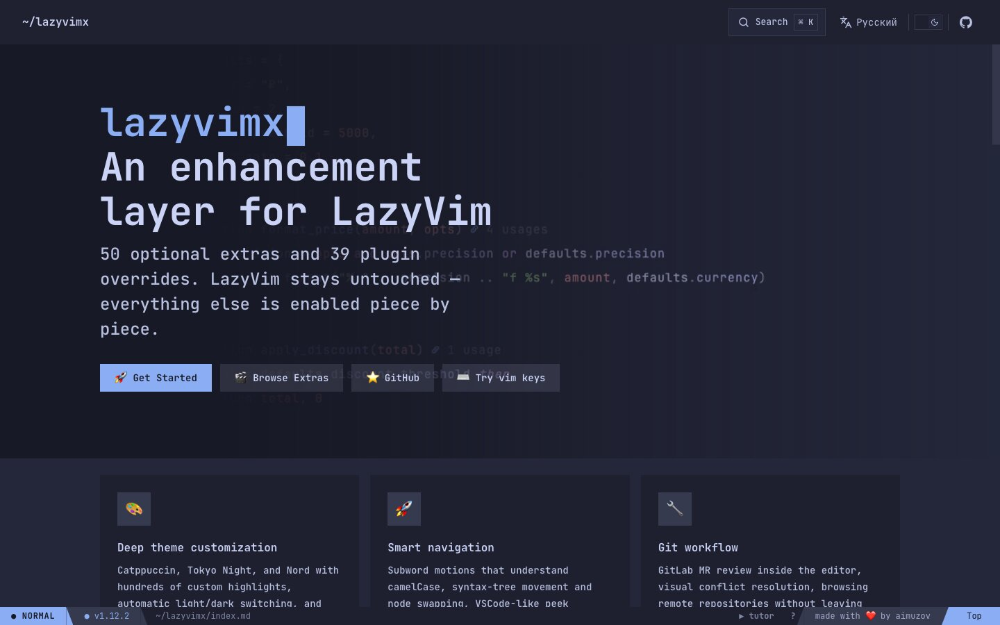
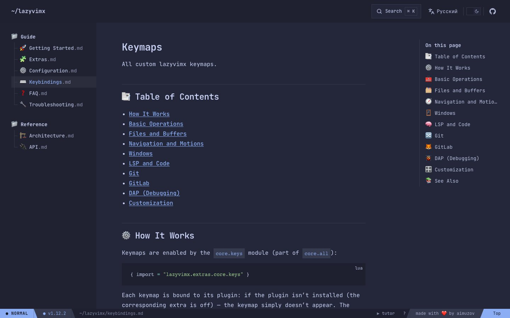

<p align="center">
	
	<a href="README.ru.md"></a>
</p>

<p align="center">
	<a href="https://lazyvimx.aimuzov.online"></a>
</p>

<p align="center">
	<a href="https://github.com/lazyvimx/site/actions/workflows/deploy.yml"></a>
	<a href="https://lazyvimx.aimuzov.online"></a>
	<a href="package.json"></a>
	<a href="https://astro.build"></a>
	<a href="https://svelte.dev"></a>
	<a href="https://github.com/lazyvimx/nvim/releases"></a>
	<a href="LICENSE"></a>
</p>

<h3 align="center">The documentation site for lazyvimx, the enhancement layer for LazyVim</h3>
<p align="center">Docs in English and Russian, dressed up as Neovim: a statusline, vim keys, a tutor and site search</p>

<table>
	<tr>
		<td width="50%" align="center"><br><b>Landing</b> with a demo recording</td>
		<td width="50%" align="center"><br><b>Docs</b> with the file tree and the statusline</td>
	</tr>
</table>

<p>Lives at <a href="https://lazyvimx.aimuzov.online">lazyvimx.aimuzov.online</a>. A static site on <a href="https://astro.build">Astro</a> with <a href="https://svelte.dev">Svelte</a> islands, made from <a href="https://github.com/aimuzov-projects/infra-site-template">infra-site-template</a>.</p>

## What's inside

- **Docs** (`/getting-started`, `/extras`, …, and the same under `/ru/`): page texts live in [lazyvimx/nvim](https://github.com/lazyvimx/nvim) (`README*.md`, `docs/*.md`). Edit them there, this repo only lays them out.
- **Landing pages** (`/`, `/ru/`): hero with the demo recording and the feature tiles from [`src/frontend/data/home.ts`](src/frontend/data/home.ts).
- **The Neovim layer** ([`src/frontend/components/vim`](src/frontend/components/vim)): lualine-style statusline, `j`/`k`/`gg`/`G`/`}`/`L`/`H` and friends, link hints on `f`, a command line on `:`, which-key, an interactive tutor. Keys work on the Russian layout too.
- **Search**: [Pagefind](https://pagefind.app) in the dialog from [infra-site-kit](https://github.com/aimuzov/infra-site-kit), a separate index per language. Opens with `/`, Cmd/Ctrl-K or the button in the header.
- **Demo recordings**: mp4 from the `assets` branch of lazyvimx/nvim via jsDelivr, loaded only once scrolled into view.
- **Analytics**: Yandex Metrika from [infra-site-kit](https://github.com/aimuzov-projects/infra-site-kit), it adds its own sources to the CSP.

## How it works

- [`scripts/sync-docs.ts`](scripts/sync-docs.ts) takes the docs from `../nvim`, from `LAZYVIMX_DIR` or from a fresh clone of the `main` branch and writes them to `src/frontend/content/docs/{en,ru}`. The lazyvimx version for the statusline goes to `src/frontend/data/version.json`. Both are generated and ignored by git; `dev`, `build` and `check` run the sync themselves.
- [`src/sync`](src/sync): pure text transforms of the docs and a Sätteri plugin for headings, code blocks and external links. Heading slugs follow VitePress, so links from the old site keep working.
- [`src/frontend`](src/frontend): the site itself, the `srcDir` in `astro.config.mjs`. Imports go through `#frontend/*`.

Everything about the server lives in [`deploy`](deploy): Dockerfile, compose and nginx. The image pulls the docs from `lazyvimx/nvim@main` on every build, so fresh docs don't need a site release.

## Running

Stack and layout come from [infra-site-template](https://github.com/aimuzov-projects/infra-site-template): Astro + Svelte 5, Prettier, oxlint, stylelint (BEM), `node --test` for unit tests, Playwright for e2e. Prettier, stylelint, oxlint and Playwright configs and the CI steps come from [infra-site-kit](https://github.com/aimuzov-projects/infra-site-kit). Node comes from [`mise.toml`](mise.toml).

```sh
cp .env.example .env   # may stay empty, but the file must exist
npm ci
npm run dev
```

Search works only in the built site: `npm run build && npm run preview`.

Before a commit, the same checks as CI:

```sh
npm run format:check && npm run lint:js && npm run lint:css && npm run check && npm test && npm run build
```

E2E tests in [`e2e`](e2e) build the site and open it in Chromium: every sitemap page answers without console errors and passes axe in both schemes, the theme switch and Metrika behave, the vim keys and search work in both languages.

```sh
npm run test:e2e
```

## Content Security Policy

The build puts a CSP with hashes of the Astro scripts and styles into every page (`security.csp` in `astro.config.mjs`). On top of the template the site allows jsDelivr for the demo recordings, Repobeats for the README activity image, WebAssembly for Pagefind and inline `style` attributes for the Shiki highlighting. In `npm run dev` there is no policy, so violations show up only after `npm run build && npm run preview`.

## Deploy

The projects server from [infra-server](https://github.com/aimuzov-projects/infra-server): merging the release PR that release-please keeps up to date starts `deploy.yml`, which runs the checks and logs in over SSH. There the key starts the shared [`deploy/site.sh`](https://github.com/aimuzov-projects/infra-server/blob/main/deploy/site.sh), which checks out the release tag and rebuilds the `lazyvimx-site` container (nginx with the static files). The domain and TLS are held by the shared Caddy.

The deploy job runs only when the repository variable `DEPLOY_ENABLED` is `true` and the SSH key is in the `DEPLOY_SSH_KEY` secret.

A lazyvimx release only needs to redeploy the latest site tag, the image picks up fresh docs by itself: `gh workflow run deploy.yml -R lazyvimx/site -f tag=v1.2.3`. The same command with an older tag rolls back.

## License

The code is under the [MIT](LICENSE) license. The site content (texts, images, names and contacts) is not covered by it: all rights reserved.
