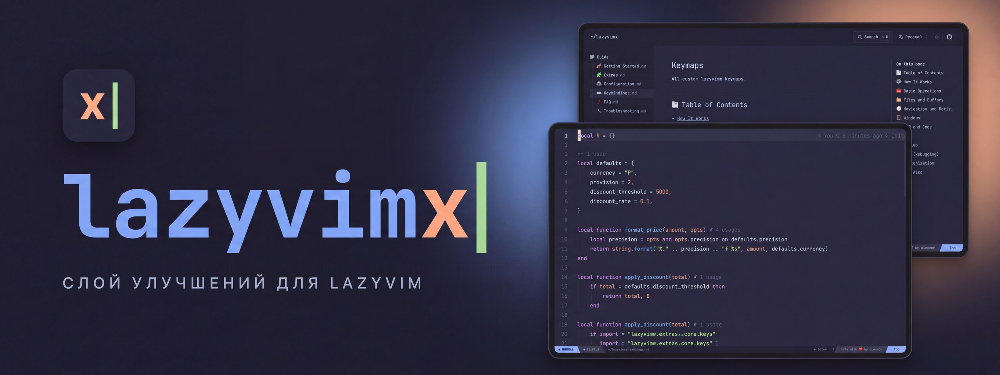

<p align="center">
	<a href="README.md"></a>
	
</p>

<p align="center">
	<a href="https://lazyvimx.aimuzov.online/ru/"></a>
</p>

<p align="center">
	<a href="https://github.com/lazyvimx/site/actions/workflows/deploy.yml"></a>
	<a href="https://lazyvimx.aimuzov.online"></a>
	<a href="package.json"></a>
	<a href="https://astro.build"></a>
	<a href="https://svelte.dev"></a>
	<a href="https://github.com/lazyvimx/nvim/releases"></a>
	<a href="LICENSE"></a>
</p>

<h3 align="center">Сайт документации lazyvimx, слоя улучшений для LazyVim</h3>
<p align="center">Доки на русском и английском в обличье Neovim: статуслайн, vim-клавиши, туториал и поиск по сайту</p>

<table>
	<tr>
		<td width="50%" align="center"><br><b>Лендинг</b> с демо-записью</td>
		<td width="50%" align="center"><br><b>Доки</b> с деревом файлов и статуслайном</td>
	</tr>
</table>

<p>Живёт на <a href="https://lazyvimx.aimuzov.online/ru/">lazyvimx.aimuzov.online</a>. Статичный сайт на <a href="https://astro.build">Astro</a>, интерактивные островки на <a href="https://svelte.dev">Svelte</a>, собран из <a href="https://github.com/aimuzov-projects/infra-site-template">infra-site-template</a>.</p>

## Что внутри

- **Документация** (`/getting-started`, `/extras`, … и то же под `/ru/`): тексты страниц живут в [lazyvimx/nvim](https://github.com/lazyvimx/nvim) (`README*.md`, `docs/*.md`). Править их нужно там, здесь они только раскладываются по страницам.
- **Лендинги** (`/`, `/ru/`): hero с демо-записью и плитки возможностей из [`src/frontend/data/home.ts`](src/frontend/data/home.ts).
- **Слой Neovim** ([`src/frontend/components/vim`](src/frontend/components/vim)): статуслайн в духе lualine, `j`/`k`/`gg`/`G`/`}`/`L`/`H` и компания, метки на ссылках по `f`, командная строка по `:`, which-key, интерактивный туториал. Клавиши работают и на русской раскладке.
- **Поиск**: [Pagefind](https://pagefind.app) в окне из [infra-site-kit](https://github.com/aimuzov/infra-site-kit), отдельный индекс на каждый язык. Открывается по `/`, Cmd/Ctrl-K или кнопкой в шапке.
- **Демо-записи**: mp4 из ветки `assets` репозитория lazyvimx/nvim через jsDelivr, грузятся, только когда до них доскроллили.
- **Аналитика**: Яндекс Метрика из [infra-site-kit](https://github.com/aimuzov-projects/infra-site-kit), свои источники в CSP она добавляет сама.

## Как устроено

- [`scripts/sync-docs.ts`](scripts/sync-docs.ts) берёт доки из `../nvim`, из `LAZYVIMX_DIR` или из свежего клона ветки `main` и пишет их в `src/frontend/content/docs/{en,ru}`. Версия lazyvimx для статуслайна уходит в `src/frontend/data/version.json`. Оба сгенерированы и в git не попадают, `dev`, `build` и `check` запускают синк сами.
- [`src/sync`](src/sync): чистые преобразования текста доков и плагин Sätteri для заголовков, блоков кода и внешних ссылок. Слаги заголовков — как у VitePress, так что ссылки со старого сайта не ломаются.
- [`src/frontend`](src/frontend): сам сайт, это `srcDir` в `astro.config.mjs`. Импорты — через `#frontend/*`.

Всё про сервер — в [`deploy`](deploy): Dockerfile, compose и nginx. Образ на каждой сборке берёт доки из `lazyvimx/nvim@main`, так что свежим докам релиз сайта не нужен.

## Запуск

Стек и раскладка — из [infra-site-template](https://github.com/aimuzov-projects/infra-site-template): Astro + Svelte 5, Prettier, oxlint, stylelint (BEM), `node --test` для unit-тестов, Playwright для e2e. Конфиги Prettier, stylelint, oxlint и Playwright и шаги CI берутся из [infra-site-kit](https://github.com/aimuzov-projects/infra-site-kit). Node берётся из [`mise.toml`](mise.toml).

```sh
cp .env.example .env   # может остаться пустым, но файл должен быть
npm ci
npm run dev
```

Поиск работает только в собранном сайте: `npm run build && npm run preview`.

Перед коммитом — те же проверки, что в CI:

```sh
npm run format:check && npm run lint:js && npm run lint:css && npm run check && npm test && npm run build
```

E2E-тесты в [`e2e`](e2e) собирают сайт и открывают его в Chromium: каждая страница из sitemap отвечает без ошибок в консоли и проходит axe в обеих темах, переключатель темы и Метрика ведут себя как надо, vim-клавиши и поиск работают на обоих языках.

```sh
npm run test:e2e
```

## Content Security Policy

Сборка кладёт в каждую страницу CSP с хешами скриптов и стилей Astro (`security.csp` в `astro.config.mjs`). Сверх шаблона сайт разрешает jsDelivr для демо-записей, Repobeats для картинки активности в README, WebAssembly для Pagefind и атрибуты `style` для подсветки Shiki. В `npm run dev` политики нет, поэтому нарушения видны только после `npm run build && npm run preview`.

## Выкладка

Сервер проектов из [infra-server](https://github.com/aimuzov-projects/infra-server): мерж релизного PR, который ведёт release-please, запускает `deploy.yml`, он гоняет проверки и заходит по SSH. Там ключ запускает общий [`deploy/site.sh`](https://github.com/aimuzov-projects/infra-server/blob/main/deploy/site.sh), который переключается на релизный тег и пересобирает контейнер `lazyvimx-site` (nginx со статикой). Домен и TLS держит общий Caddy.

Job выкладки запускается, только когда переменная репозитория `DEPLOY_ENABLED` равна `true`, а SSH-ключ лежит в секрете `DEPLOY_SSH_KEY`.

Релизу lazyvimx достаточно передеплоить последний тег сайта, свежие доки образ подтянет сам: `gh workflow run deploy.yml -R lazyvimx/site -f tag=v1.2.3`. Та же команда с прошлым тегом откатывает сайт.

## Лицензия

Код распространяется по лицензии [MIT](LICENSE). Содержимое сайта (тексты, изображения, имена и контакты) под неё не подпадает: все права защищены.
